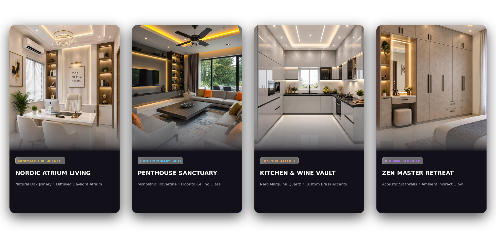

<div align="center">

# 🏛️ LADIYA INTERIOR — Luxury Architecture & Bespoke Design
### Turnkey Residential & Penthouse Interior Studio Engineered with Next.js 16 & Framer Motion

[](https://ladiyainterior.pages.dev/)
[](https://nextjs.org/)
[](https://react.dev/)
[](https://tailwindcss.com/)
[](https://www.framer.com/motion/)
[](https://ladiyainterior.pages.dev/)
[](LICENSE)

<br/>

**[⚡ View Live Production Deployment](https://ladiyainterior.pages.dev/)** &nbsp;•&nbsp; **[📦 GitHub Repository](https://github.com/labibfohayer/Ladiya-Interior)**

<br/>



</div>

---

## 📌 Architectural Overview

**Ladiya Interior (লাদিয়া ইন্টেরিয়র)** is a premier architectural and bespoke interior design studio catering to prestigious residential addresses in Gulshan and Banani, Dhaka. The platform showcases custom spatial millwork, turnkey penthouse renovations, noble stone curation, and 3D architectural visualizations.

Built with **Next.js 16 (App Router)**, **React 19**, and **Tailwind CSS v4**, the application combines tactile material realism with high-velocity digital performance—delivering fluid staggered gallery transitions, interactive spatial lookbooks, and an editorial design journal.

---

## ⚡ Key Engineering Highlights

1. **Curated Spatial Concept Galleries:**
   - 5+ Distinct architectural living concepts (Nordic Atrium, Contemporary Penthouse, Monolithic Travertine, Zen Master Sanctuary).
   - Responsive multi-column grid layouts with fluid micro-interactions.

2. **Sub-Pixel Kinetic Navigation:**
   - 60fps+ inertial smooth scrolling powered by **Lenis**.
   - Staggered scroll-triggered entrance choreographies built with **Framer Motion 12**.

3. **Design Journal & Editorial Case Studies:**
   - Markdown-ready editorial publishing pipeline detailing material specifications, lighting topologies, and bespoke joinery plans.

---

## 🛠️ Tech Stack & Production Architecture

| Layer | Technologies | Purpose |
| :--- | :--- | :--- |
| **Framework** | Next.js 16.4 (App Router), React 19, TypeScript | Server components, zero-runtime hydration cost |
| **Styling** | Tailwind CSS v4, PostCSS | Modern CSS engine, fluid design tokens |
| **Motion** | Framer Motion 12.4, Lenis 1.3 Smooth Scroll | Sub-frame smooth scrolling & micro-interactions |
| **Icons & UI** | Lucide React | Minimalist vector interface icons |
| **Deployment** | Cloudflare Pages, Edge CDN Distribution | Ultra-fast global static delivery |

---

## 🚀 Getting Started & Local Development

```bash
# Clone the repository
git clone https://github.com/labibfohayer/Ladiya-Interior.git
cd Ladiya-Interior

# Install dependencies
npm install

# Start development server
npm run dev
```

Open [http://localhost:3000](http://localhost:3000) to view the live project.

---

## 📄 License
This project is open-source and distributed under the [MIT License](LICENSE).
